# STAGC：基于 ConvLSTM 与注意力门控的短时交通速度预测

STAGC 是一个轻量的时空预测模型，用于区域级短时交通速度预测。模型将稀疏的路网传感器映射到 16×16 网格，并以 5 分钟为步长预测未来 1 小时的速度场。

> 名称说明：STAGC 是本项目对 Spatio-Temporal Attention Gated ConvLSTM 的缩写，不是已发表的同名交通预测模型。公开文献中另有 STAGCN、ST-GACN、ST-GATC 等相近名称，请注意区分。

## 项目概述

短时速度预测可用于导航 ETA、车队调度和交通监测。交通网络本身是非欧几里得结构，图模型能够保留道路拓扑，但依赖预定义的邻接矩阵，计算成本会随节点规模增长。网格卷积避免了邻接矩阵，单格计算成本固定，但会损失一部分道路连通性。

STAGC 保留网格建模方式，并在每个 ConvLSTM 单元前加入 STAG 空间注意力门控。门控利用上一时刻的隐状态对当前输入进行重加权，解码器则通过时间注意力从编码器历史状态中检索相关信息。模型输入为 12 帧速度与时间特征，输出为未来 12 帧速度图，损失函数只在有有效观测的格点上计算掩码 Huber 损失。

模型定位为区域级 16×16 网格、1 小时预测窗口，不使用事故、天气、流量或排队长度等外部数据。

## 实验结果

测试集，仅统计有效传感器观测，12 步预测（5–60 分钟）：

| 数据集 | 配置 | 平均 MAE | 60min MAE | 60min RMSE | 60min MAPE |
|---|---|---:|---:|---:|---:|
| METR-LA | 线性时间编码 | 2.711 | 3.099 | 5.302 | 6.84% |
| METR-LA | 周期时间编码 | **2.678** | **3.028** | **5.209** | **6.70%** |
| METR-LA | 周期编码 + 残差预测 | 2.685 | 3.104 | 5.333 | 6.97% |
| PeMS-BAY | 线性时间编码 | 1.432 | 1.731 | 3.340 | 3.28% |
| PeMS-BAY | 周期时间编码 | 1.438 | **1.717** | 3.265 | 3.25% |
| PeMS-BAY | 周期编码 + 残差预测 | **1.386** | 1.723 | **3.258** | 3.26% |

逐 horizon 指标见 `results/reference/`。

16 核笔记本 CPU 上的推理 benchmark：

| 项目 | 数值 |
|---|---|
| 参数量 | 0.92M |
| PyTorch 权重 | 3.69 MB |
| ONNX 模型 | 4.24 MB |
| ONNX Runtime，batch=1 | 23.4 ms，42.7 samples/s |

延迟在笔记本 CPU 上测得，不代表 Jetson、树莓派等真实边缘设备。

## 模型结构

- 输入：12 帧 ×（速度 + 时间特征），16×16 网格
- 编码器：两层 ConvLSTM，每个单元前接 STAG 空间门控
- 解码器：12 步递归预测 + 时间注意力
- 损失：只在有效观测格点上计算的掩码 Huber 损失
- 输出：未来 12 帧速度图

时间特征支持两种形式：线性编码（时段、星期）和周期编码（sin/cos）。`tanh` 变体使用 tanh 门控，并在解码器中加入未来时间特征和置信度头，作为实验对照。

## 图表说明

### 模型结构

总览图展示编码器-解码器路径、空间门控、时间注意力分支和融合层。

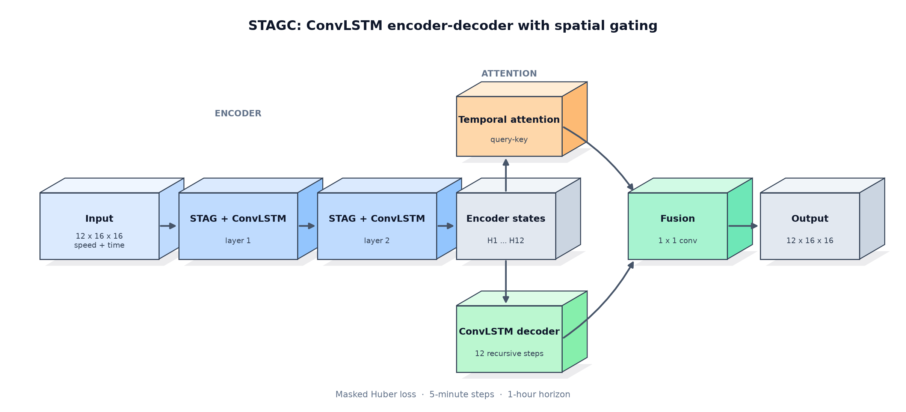

详细结构拆成四个模块，分别说明通道数、张量形状、门控函数、激活函数和残差路径。图中堆叠矩形表示带通道维度的特征图/张量，单层矩形表示卷积、激活、Softmax 等操作。

#### STAG 空间门控

输入 $x_t$ 与上一时刻隐状态 $h_{t-1}$ 拼接后，经过 7×7 卷积（69→1 通道）和 Sigmoid 得到空间门控 $g_t$。输出为 $x'_t = x_t \odot (1+g_t)$，虚线表示从 $x_t$ 到乘法节点的残差路径。

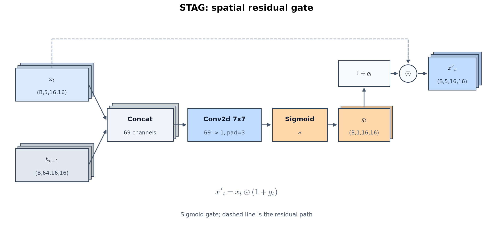

#### ConvLSTM 单元

拼接后的特征经过 3×3 卷积（69→256 通道），拆成输入门、遗忘门、输出门和候选状态四组，每组 64 通道。输入门、遗忘门、输出门使用 Sigmoid，候选状态使用 Tanh；随后按 $c_t=f_t\odot c_{t-1}+i_t\odot g_t$ 和 $h_t=o_t\odot\tanh(c_t)$ 更新状态。

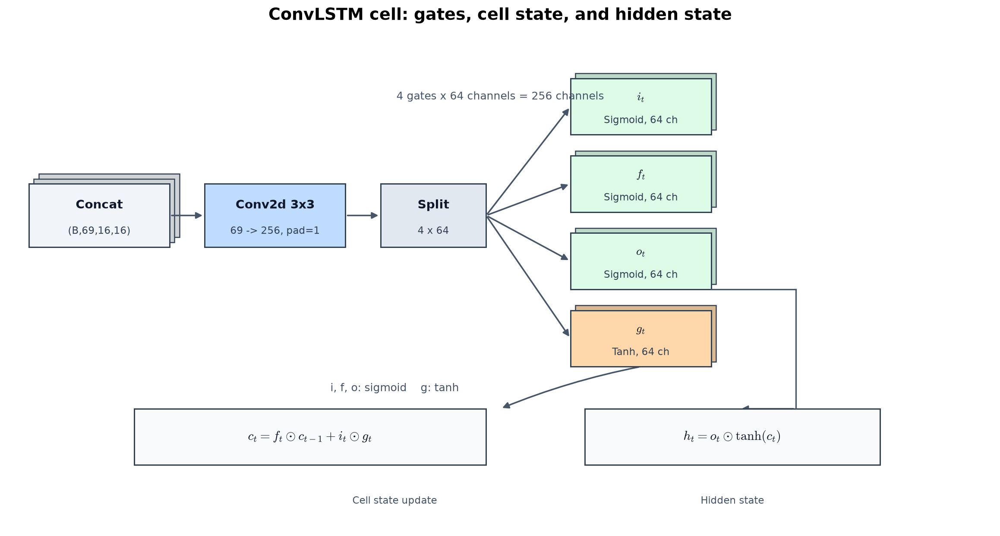

#### 时间注意力与融合

解码器状态和编码器历史状态先做全局平均池化，再通过 Q/K 线性层（64→64）计算缩放点积，Softmax 得到 12 个历史时刻的权重；V 直接使用编码器状态，不做额外投影。上下文向量与解码器状态拼接后，经过 1×1 卷积（128→64）和 Dropout 得到融合特征。

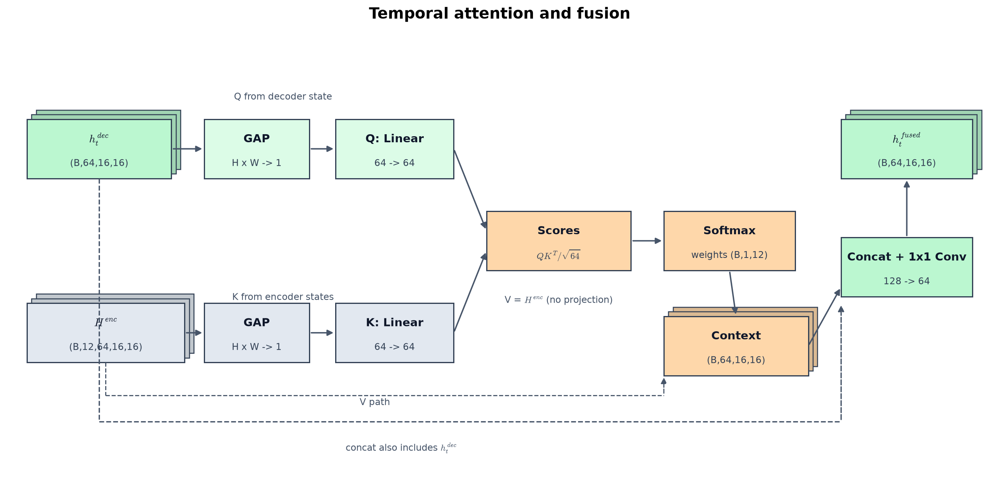

#### 输出层与损失

融合特征经过 1×1 卷积（64→1）输出单通道速度图，输出层使用线性激活，不加 Sigmoid/Tanh；随后按训练集的最小值和最大值反归一化。损失函数为掩码 Huber 损失，只在有效观测格点上计算；预测帧会作为下一步解码器输入，递归 12 次。

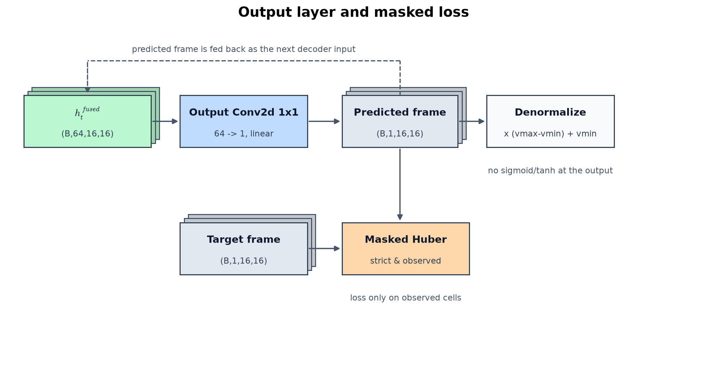

### 逐 horizon 精度

左图为 METR-LA，右图为 PeMS-BAY。每条曲线对应一种输入/目标配置：线性时间编码、周期时间编码、周期编码 + 残差预测。

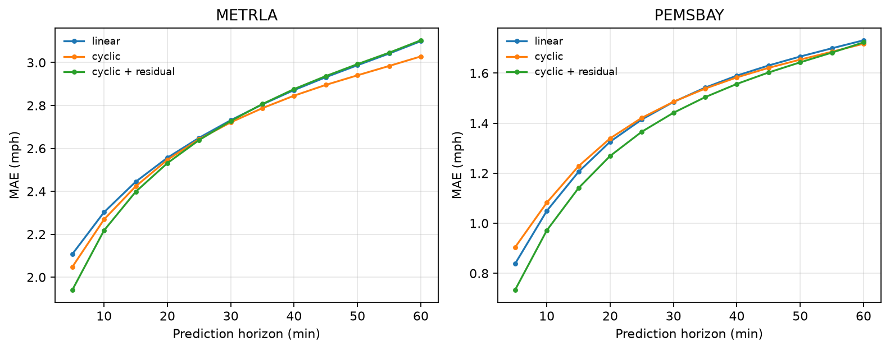

### 地图预测结果

每张地图对比 15、30、60 分钟的预测值与真实值。点为传感器位置，按速度着色；上排为真实值，下排为模型预测。两个数据集使用不同的地理范围，因此分别展示。

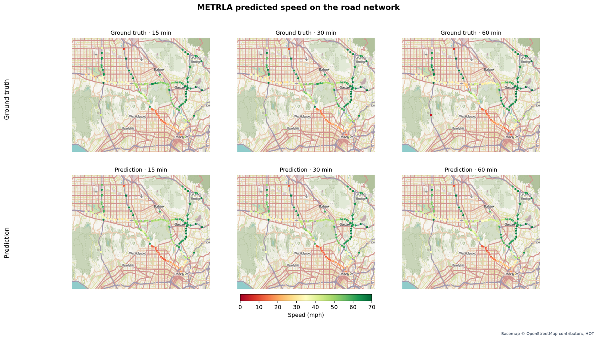

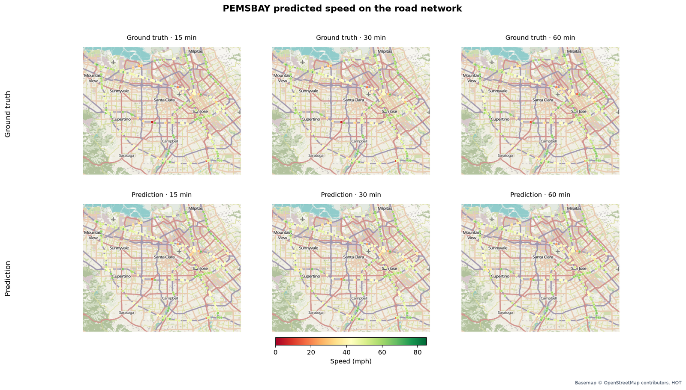

底图：© OpenStreetMap contributors, HOT。

### 误差分析

下图统计 METR-LA 测试集在 60 分钟处的逐格绝对误差。误差集中在少数格点，而不是均匀分布。

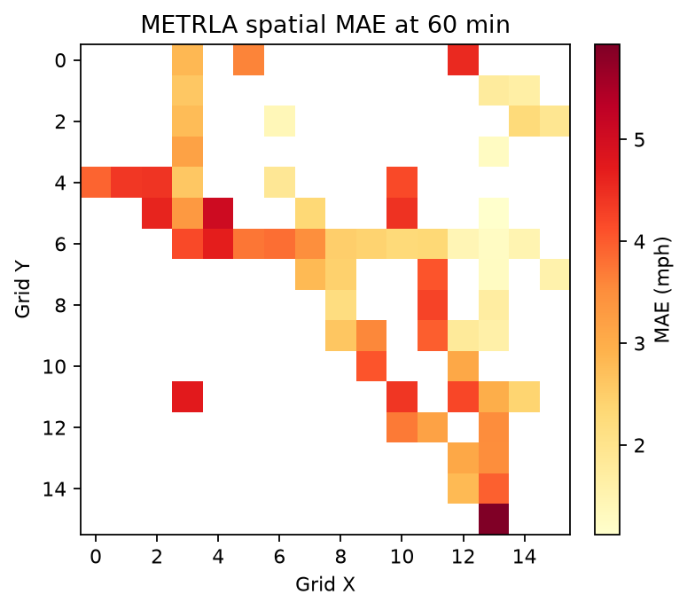

下图为 PeMS-BAY 的同一分析。颜色尺度按数据集单独设置，建议比较空间分布形态，而不是直接比较绝对色值。

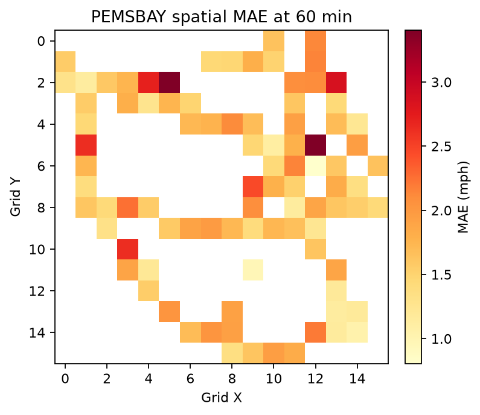

下面是 METR-LA 的一个测试窗口，展示 60 分钟预测值与真实值。

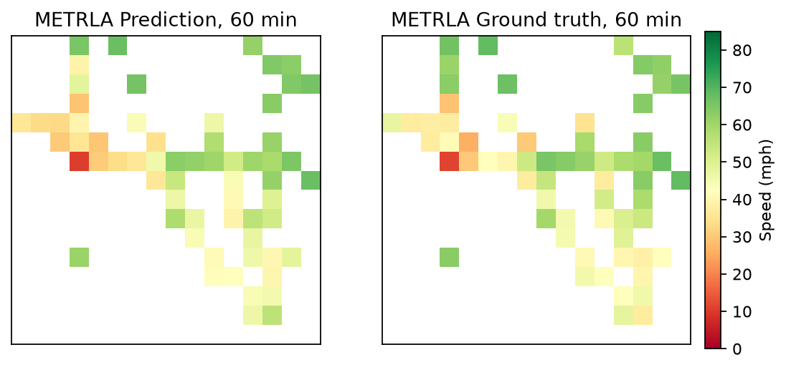

PeMS-BAY 的对应示例。

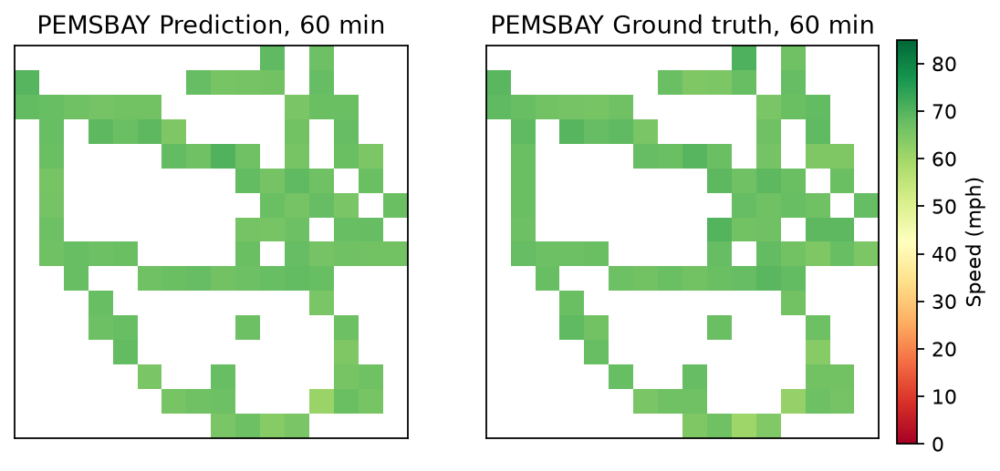

图表由 `scripts/make_figures.py`、`scripts/make_model_details.py` 和 `scripts/make_map_figures.py` 生成。地图叠加图需要先安装 `requirements-figures.txt`。

## 仓库结构

```
data_core/data.py              数据加载、时间切分、指标
models/stagc.py                基础模型
models/stagc_tanh.py           tanh/置信度变体
train.py                       训练
eval.py                        评测
scripts/prepare_data.py        原始传感器数据 -> 网格张量
scripts/audit_data.py          网格数据审计
scripts/benchmark_infer.py     CPU/ONNX benchmark
scripts/make_figures.py        README 图表
scripts/make_model_details.py  详细模型图
scripts/make_map_figures.py    地图叠加图
assets/                        生成的图表
tests/                         数据与指标测试
results/reference/             参考指标与训练日志
kaggle/                        Kaggle 训练入口
```

## 环境安装

```bash
python -m pip install -r requirements.txt
```

## 数据准备

下载 METR-LA 和 PeMS-BAY，并将原始文件放到 `data/` 下。具体文件名见 `data/README.md`。

生成网格张量：

```bash
python scripts/prepare_data.py --dataset metrla
python scripts/prepare_data.py --dataset pemsbay
```

输出文件：

```
data/metrla_grid_speed.npy
data/metrla_grid_observed.npy
data/metrla_grid_strict_mask.npy
data/metrla_grid_dilated_mask.npy
data/metrla_grid_meta.json
```

## 训练

```bash
python train.py --dataset metrla --model base \
  --time-encoding cyclic --residual \
  --epochs 40 --batch-size 32 --seed 42 --patience 10
```

权重保存到 `models/`，日志保存到 `results/`。  
如果存在 `models/<tag>_last.pth`，训练会自动续训；使用 `--fresh` 可以强制从头训练。

## 评测

```bash
python eval.py --checkpoint models/base_cyclic_s42.pth --split test
```

## 测试

```bash
python -m unittest discover -s tests -v
```

部分测试在缺少权重或样本数据时会自动跳过。

## 项目说明与 AI 辅助

这是一个个人学习与作品集项目，重点在于完整走通数据准备、模型训练、评测和 CPU 推理的流程。

代码和文档的部分内容使用了 AI 辅助起草。所有报告数字均来自实际运行本仓库代码；已知局限列在下方以及 `MODEL_CARD.md` 中。作者对内容和实现验证负责。

## 局限

- 16×16 网格是区域级分辨率，不是车道级。
- 预测窗口只有 1 小时。
- 不使用事故、天气、流量或排队长度数据。

## 许可证

MIT，详见 `LICENSE`。
